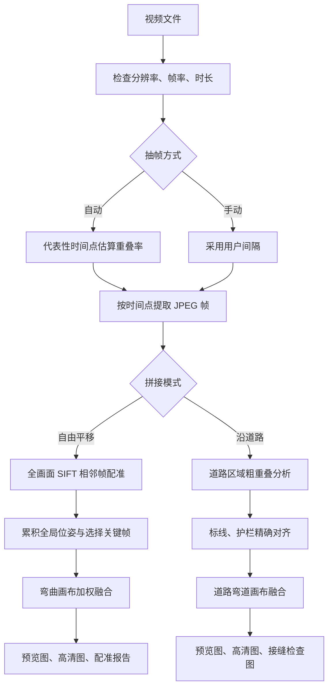

# 航拍道路拼接工具：开发与交接文档

## 0.3.6 release note — 2026-08-17

- Free translation now selects sparser keyframes and keeps one source image dominant through most overlap. Only a narrow equal-authority handoff is blended, avoiding the former soft double-image effect on markings and guardrails.
- Free-alignment cache `free_alignment_v1.npz` is tagged `free-quality-v2`; old caches recompute automatically. Free-render manifests are tagged `free-sharp-handoff-v4` so old result images rerender.
- Road alignment cache is tagged `road-adaptive-direction-v2`. The road engine detects reverse flight and splits an oversized sparse-keyframe pair by inserting a midpoint before reporting an error. This addresses errors such as frame 1 to frame 23 having abnormal movement.
- UI adds **Reset current task**. It always clears the form and task state; optional cache cleanup deletes only `处理数据` after confirmation and never deletes completed panorama images.
- Regression: `python -m unittest discover -s tests -q` => 20 passed. Real-video T1 road (4 s, preview) and free translation (1 s, preview) completed successfully. Output folders: `test_artifacts\\road_adaptive_t1_v036` and `test_artifacts\\free_sharp_t1_v036`.
- Packaged archive: `dist\\RoadStitcher-0.3.6-windows-x64.zip` (102,959,071 bytes; SHA-256 `51F88191E8C5504E22E52D76B363EEEC2F847DD739ABA8667A64FB69EF88793F`). Archive inspection: 239 entries, including `RoadStitcher.exe` and the application icon.

## 0.3.7 free-stitch sharpness correction — 2026-08-17

- Free mode now uses hard per-pixel source ownership in overlaps: it never averages two registered source pixels, eliminating residual double-image softening.
- The default high-resolution frame width is now 1920px (was 1200px). Preview remains 600px for speed; quality review must use the file suffixed `自由拼接_高清.jpg`.
- T1 free high-resolution regression completed: 2723 × 10146 px, stored under `test_artifacts\\free_native_hardcut_t1_v037`.

## 0.3.8 free-stitch seam selection — 2026-08-17

- Free mode now uses OpenCV dynamic-programming color-gradient seam finding before assigning a single sharp source to each output pixel. This retains the no-blur rule while avoiding broad rectangular handoff edges.
- Regression source `F:\\Video Project 2.mp4`: automatic 5 s sampling, 5 frames, 4526 × 1262 high-resolution result stored in `test_artifacts\\free_video_project_2_seam_v038`.
- T1 multi-frame regression: 62 extracted frames, 21 selected keyframes, 2803 × 10226 high-resolution result stored in `test_artifacts\\free_t1_seam_v038`.
- Packaged archive: `dist\\RoadStitcher-0.3.8-windows-x64.zip` (102,960,514 bytes; SHA-256 `4E20EA1A75CC2042C526B09CC4706C1B43C0FA8CC2CF850559CC27148EC19220`). Archive inspection: 239 entries, including `RoadStitcher.exe`.

> 文档状态：可交接  
> 对应软件版本：`0.3.6`  
> 最后核对日期：2026-07-31  
> 工程目录：`C:\Users\DELL\Documents\New project`

本文档是本工程的主交接资料，面向后续开发者以及新的 Codex 会话。它记录当前已经实现并验证的能力、代码结构、算法假设、运行与打包方法、回归基准、已知问题和建议路线图。

开始继续开发前，建议先完整阅读：

1. “当前结论与交接警告”；
2. “快速开始”；
3. “缓存与续算规则”；
4. “回归测试基准”；
5. “已知限制、技术债与优先级”。

---

## 1. 项目目标

软件用于处理垂直向下拍摄、飞行高度相对稳定、相机随无人机平移的航拍视频，将视频中的地面或道路画面拼合成一张长条或弯曲轨迹全景图。

当前重点解决的是：

- 单方向直线道路；
- 带一定弧度的道路；
- 不局限于道路中心区域的自由平移航线；
- 相邻画面重叠充分时的自动配准；
- 接缝位置错位、护栏和标线断裂；
- 亮度差导致的明显拼接边界；
- 大视频不整体载入内存，按时间点抽帧处理；
- Windows 图形界面、断点状态和便携打包。

当前产品定位是“工程检查、道路浏览、地面长图生成工具”，不是测绘级正射影像软件。软件尚未使用相机内参、GPS、IMU、地面控制点或数字高程模型，因此不能替代 Pix4D、Metashape 等测绘流程。

---

## 2. 当前结论与交接警告

### 2.1 当前可用状态

- 当前版本：`0.3.6`。
- Windows 图形界面已经完成一轮重新设计。
- “自由平移拼接”已用真实视频 `T1.mp4`、`T2.mp4` 验证。
- “沿道路拼接”保留了此前实拍验证过的道路专用算法。
- 17 项自动化测试全部通过。
- 已生成可携带的 Windows 文件夹版和 ZIP 包。
- 打包版已通过 24 秒样例视频的完整流程冒烟测试。

### 2.2 必须先处理的 Git 问题

当前仓库位于 `master` 分支，但还没有任何提交；现有文件在 Git 看来均为未跟踪文件。后续多人开发或大规模重构前，应先：

1. 检查 `.gitignore` 是否符合团队需要；
2. 明确是否提交测试视频和生成结果；
3. 建立一次“当前可运行基线”提交；
4. 再从基线创建功能分支。

不要在尚未建立基线时使用 `git reset --hard`、`git clean` 或批量删除命令。`videos` 和输出目录中包含真实测试素材与已验证成果。

### 2.3 当前最容易踩坑的缓存问题

任务支持续算，但自由拼接缓存 `free_alignment_v1.npz` 目前只用抽帧数量 `source_count` 判断是否可复用，没有记录：

- 原视频内容哈希；
- 抽帧时间列表；
- 抽帧间隔；
- 算法版本和关键参数；
- 输入帧文件哈希；
- 软件版本。

同时，目标图片已经存在时会跳过重新渲染。因此修改算法、间隔、尺寸或源视频后，如果继续使用原输出目录，可能得到旧缓存或旧图片。

安全做法是：每次参数或算法发生实质变化，使用新的输出目录。只有确认目录归属和需要重新计算的范围后，才清理相应缓存或结果文件。

### 2.4 打包时必须复制整个目录

当前 PyInstaller 使用 `onedir` 文件夹模式。发布时必须复制：

```text
dist\RoadStitcher\
```

或分发：

```text
dist\RoadStitcher-0.3.6-windows-x64.zip
```

不能只复制 `RoadStitcher.exe`，否则 Qt、OpenCV、FFmpeg 和其他运行库不完整。

---

## 3. 当前工程资产

### 3.1 核心目录

```text
New project/
├─ road_stitcher/
│  ├─ __init__.py
│  ├─ cli.py
│  ├─ config.py
│  ├─ cv_compat.py
│  ├─ extractor.py
│  ├─ free_stitch.py
│  ├─ interval.py
│  ├─ legacy_bridge.py
│  ├─ logging_utils.py
│  ├─ media.py
│  ├─ pipeline.py
│  ├─ state.py
│  ├─ ui.py
│  └─ assets/
│     └─ road_stitcher_icon_v2.png
├─ assets/
│  └─ road_stitcher_v2.ico
├─ scripts/
│  ├─ create_smoke_sample.py
│  └─ run_free_frames.py
├─ tests/
│  ├─ test_core.py
│  └─ test_free_stitch.py
├─ videos/
│  ├─ T1.mp4
│  ├─ T2.mp4
│  ├─ T1_拼接结果/
│  └─ T2_拼接结果/
├─ test_artifacts/
├─ analyze_aerial_overlap.py
├─ optimize_aerial_road_stitch.py
├─ extract_aerial_frames.py
├─ stitch_aerial_road_strip.py
├─ run_road_stitcher.py
├─ build_windows.ps1
├─ pyproject.toml
├─ requirements.txt
├─ README.md
└─ DEVELOPMENT_HANDOFF.md
```

工作区内的 `spreadsheet_work`、`vehicle-counter-desktop-dev-doc.md` 等内容与本软件无关，不应纳入本工程重构范围。

### 3.2 文件职责

| 文件 | 职责 |
|---|---|
| `run_road_stitcher.py` | 源码运行和 PyInstaller 的程序入口 |
| `road_stitcher/cli.py` | GUI/CLI 分派、CLI 参数、原生崩溃日志 |
| `road_stitcher/ui.py` | PySide6 中文桌面界面、工作线程与事件队列 |
| `road_stitcher/config.py` | 任务配置、参数校验和输出路径约定 |
| `road_stitcher/state.py` | 任务阶段、`job.json`、暂停/继续/取消 |
| `road_stitcher/pipeline.py` | 视频处理总编排、缓存续算、输出注册 |
| `road_stitcher/media.py` | 视频参数读取、支持中文路径的图片读写 |
| `road_stitcher/interval.py` | 自动抽帧间隔评估 |
| `road_stitcher/extractor.py` | 按时间点抽帧和抽帧完整性检查 |
| `road_stitcher/free_stitch.py` | 自由平移配准、轨迹累积、关键帧选择和融合 |
| `road_stitcher/legacy_bridge.py` | 将道路专用基线脚本接入新流水线 |
| `analyze_aerial_overlap.py` | 道路模式粗配准基线 |
| `optimize_aerial_road_stitch.py` | 道路模式精配准与弯道渲染基线 |
| `tests/test_core.py` | 配置、状态、锁重试、控制和工具函数测试 |
| `tests/test_free_stitch.py` | 合成弯曲轨迹的配准与渲染测试 |
| `scripts/create_smoke_sample.py` | 从长视频生成短冒烟样例 |
| `scripts/run_free_frames.py` | 绕过视频抽帧，直接测试自由拼接引擎 |
| `build_windows.ps1` | 创建环境、安装依赖、PyInstaller 打包、ZIP 发布 |

根目录中的道路基线脚本在新实现完全通过实拍回归前不应删除。`legacy_bridge.py` 会动态导入它们，打包脚本也把它们列为隐藏导入。

---

## 4. 软件运行架构

### 4.1 总体数据流



### 4.2 任务阶段

`JobStage` 的持久化状态如下：

```text
created
inspecting
recommending_interval
extracting
analyzing_overlap
aligning
rendering_preview
rendering_high
completed
failed
cancelled
```

每次状态更新写入结果目录下的
`处理数据\job.json`。详细运行消息写入
`处理数据\job.log`。

### 4.3 GUI 的线程模型

GUI 不能直接在界面主线程中执行耗时的 OpenCV 处理，否则界面会卡住。但本项目也不能在 PySide `QThread` 中直接初始化和运行 OpenCV/FFmpeg。

当前稳定实现：

1. 在 GUI 主线程中先调用 `inspect_video`，完成视频组件预热和输入预检；
2. 使用标准库 `threading.Thread` 运行 `PipelineRunner`；
3. 工作线程只向 `queue.Queue` 写普通 Python 数据；
4. GUI 使用 75 ms 的 `QTimer` 轮询队列；
5. 所有界面控件更新只发生在 GUI 主线程；
6. 工作线程中不创建、不持有、不操作 Qt 对象。

这是一个经过真实崩溃定位后建立的重要约束，后续不要轻易改回 `QThread + Qt Signal` 的处理路径。

### 4.4 已修复的 GUI 原生崩溃

旧版本点击“开始处理”后会直接闪退。Windows 事件查看器记录：

```text
fault module: Qt6Gui.dll
exception code: 0xc0000005
```

根因路径与 PySide `QThread`、OpenCV/FFmpeg 原生初始化以及跨线程 GUI 信号交互有关。改为“主线程预检 + Python 工作线程 + 队列 + QTimer”后，源码版和打包版冒烟测试均完成。

程序启动时启用 `faulthandler`。原生崩溃日志位置：

```text
%LOCALAPPDATA%\RoadStitcher\native_crash.log
```

---

## 5. 配置模型

`JobConfig` 的主要字段与默认值：

| 字段 | 默认值 | 说明 |
|---|---:|---|
| `video_path` | 必填 | 输入视频 |
| `output_dir` | 必填 | 任务专用输出目录 |
| `project_name` | `航拍道路拼接` | 输出文件名前缀 |
| `stitch_mode` | `road` | `road` 或 `free` |
| `interval_mode` | `auto` | `auto` 或 `manual` |
| `interval_seconds` | `2.0` | 手动间隔或默认占位值 |
| `road_left_ratio` | `0.24` | 道路模式分析区左边界 |
| `road_right_ratio` | `0.76` | 道路模式分析区右边界 |
| `make_preview` | `True` | 生成预览图 |
| `make_high_resolution` | `True` | 生成高清图 |
| `preview_frame_width` | `600` | 预览渲染的单帧目标宽度 |
| `high_frame_width` | `1200` | 高清渲染的单帧目标宽度 |
| `preview_max_canvas_pixels` | `45,000,000` | 预览画布像素上限 |
| `high_max_canvas_pixels` | `110,000,000` | 高清画布像素上限 |
| `jpeg_quality` | `94` | 抽帧 JPEG 质量 |

关键校验：

- 视频格式：MP4、MOV、M4V、AVI、MKV；
- 抽帧间隔：0.25–30 秒；
- 预览单帧宽度：320–2000；
- 高清单帧宽度：600–3840；
- JPEG 质量：80–100；
- 道路分析区域宽度不能小于画面的 20%。

抽帧目录命名会把小数点替换为下划线，例如：

```text
2 秒   -> frames_2s
2.5 秒 -> frames_2_5s
```

---

## 6. 自动抽帧间隔

### 6.1 目的

间隔过大会使相邻画面重叠不足，导致配准失败或护栏、标线错位；间隔过小会增加抽帧、特征提取和融合耗时，并可能保留过多近似重复帧。

### 6.2 当前策略

候选间隔：

```text
5, 4, 3, 2, 1.5, 1, 0.5 秒
```

代表性时间点：

```text
视频时长的 18%、38%、58%、78%
```

对每个候选间隔：

1. 将样本帧缩放到宽度 800；
2. 在指定区域使用 SIFT，最多 3500 个特征；
3. BFMatcher + 0.75 比率筛选；
4. `estimateAffinePartial2D` + RANSAC 估算相对变换；
5. 计算变换后画面与原画面的几何重叠率。

候选间隔被认为可靠，需要同时满足：

- 至少 3 个成功样本；
- 成功率至少 75%；
- 重叠率的真实中位数至少 42%。

自由模式使用约 3.5%–96.5% 的画面宽度；道路模式使用配置的道路区域。

### 6.3 已修复的中位数错误

早期实现对偶数个样本使用了错误的“中间单值”，导致 `T2` 的 5 秒间隔被误判为可靠。现在使用 `statistics.median` 的真实偶数中位数。

### 6.4 自由模式自动重试

自由模式在自动间隔下，如果配准抛出包含“重叠不足”的 `RuntimeError`，会将间隔减半后重新抽帧并重试，最低缩短到 0.5 秒。

当前只对“重叠不足”自动重试；“特征匹配不足”、尺度突变、转角过大等错误不会进入这一分支。这是后续应统一为结构化错误码的技术债。

### 6.5 当前局限

只采样 4 个代表性位置，可能错过很短的速度突增、剧烈转弯或起降段。自由模式的减半重试可以缓解，但不能替代完整的自适应抽帧。

建议未来升级为：

- 先低频扫描整段视频；
- 根据光流或特征位移动态选择下一帧；
- 按目标重叠率控制帧距；
- 自动排除静止、起飞、降落、云台转动和严重模糊片段。

---

## 7. 自由平移拼接算法

实现位置：`road_stitcher/free_stitch.py`。

### 7.1 使用场景

适合：

- 镜头基本垂直向下；
- 高度相对稳定；
- 无人机沿连续路线平移；
- 路线可以直行或逐渐转弯；
- 地面有足够纹理；
- 相邻抽帧保留足够重叠。

暂不适合：

- 往返网格扫描；
- 大范围闭环；
- 突然掉头或大角度旋转；
- 高度快速变化；
- 水面、纯色屋顶等低纹理区域；
- 高楼林立且视差严重的场景；
- 要求地理坐标和测量精度的正射成果。

### 7.2 相邻帧配准

分析宽度固定为 1000。画面边缘约 3.5% 的左右区域和 4.5% 的上下区域被弱化排除。

SIFT 参数：

```text
nfeatures = 6500
contrastThreshold = 0.018
edgeThreshold = 12
sigma = 1.4
```

匹配与稳健估计：

```text
BFMatcher: L2
KNN ratio: 0.74
最少 good matches: 24
模型: estimateAffinePartial2D
RANSAC 重投影阈值: 3.2
maxIters: 7000
confidence: 0.999
refineIters: 30
最少内点: 18
最少内点比例: 0.18
```

变换模型是“当前帧到上一帧”的二维相似变换，可表示平移、平面内旋转和统一缩放。限制：

```text
允许尺度: 0.82–1.22
单步航向变化: 不超过 35°
最小几何重叠率: 22%
```

### 7.3 全局轨迹

相邻变换按时间顺序累积：

```text
pose[n] = pose[n-1] @ transform(current -> previous)
```

这使画布能够沿实际轨迹展开，而不是强制把所有道路压成一条竖直直线。

渲染前会在 0–180° 范围搜索轴对齐外接矩形面积最小的整体
旋转角度，并做 0.05° 级细化。它只整体旋转全部位姿，不改变
帧间距离、道路弧度或局部几何。最终还会统一为纵向展开，减少
斜向路线造成的大面积白色空白。

### 7.4 关键帧选择

并非所有抽帧都参与最终融合。满足任一条件时保留新关键帧：

- 相对上一个关键帧的位移达到较短边的 20%；
- 累计旋转达到 2.5°。

首帧和末帧始终保留。

例如 `T2` 在 2.5 秒间隔下有 28 张源帧，最终选择 19 张关键帧。中间有一段无人机近似悬停，多个相邻帧位移接近零，因此被压缩。

### 7.5 画布与融合

渲染步骤：

1. 用关键帧全局位姿计算所有变换后边界；
2. 根据目标单帧宽度和最大画布像素数选择安全缩放；
3. 将每个关键帧局部透视变换到全局画布；
4. 使用中心到边缘递减的权重；
5. 在稳定重叠区计算每通道亮度中位数差；
6. 每通道亮度补偿限制在 ±18；
7. 进行加权累积；
8. 按有效置信度区域裁剪；
9. 以 JPEG 输出。

权重约为中心距离权重的 `0.72` 次幂，最小值为 `0.015`。这样可降低镜头边缘畸变和接缝硬边。

渲染器会根据 `max_canvas_pixels` 自动缩小结果，防止无限制创建大画布。最终预测画布超过安全值约 8% 时会报错。

### 7.6 输出与诊断

自由模式的用户成果位于结果目录根部：

```text
项目名_自由拼接_预览.jpg
项目名_自由拼接_高清.jpg
```

诊断和缓存位于 `处理数据` 子目录：

```text
处理数据\free_alignment_v1.npz
处理数据\free_alignment_report.json
```

`free_alignment_report.json` 包括：

- 引擎版本；
- 分析尺寸；
- 源帧数量；
- 关键帧索引；
- 每对相邻帧的匹配数；
- 内点数；
- 重投影误差；
- 几何重叠率；
- 尺度；
- 旋转角；
- 位移。

出现局部错位时，应先检查报告中对应帧对，而不是只看最终图片。

---

## 8. 沿道路拼接算法

### 8.1 现状

道路模式由新流水线调用两份经过实拍验证的基线脚本：

```text
analyze_aerial_overlap.py
optimize_aerial_road_stitch.py
```

桥接代码位于 `road_stitcher/legacy_bridge.py`。

基本流程：

1. 在道路区域分析相邻画面重叠；
2. 生成粗累计对齐矩阵；
3. 对道路标线、护栏和道路边缘做更精细的对齐；
4. 计算弯曲道路的位姿与位移；
5. 生成预览图、高清图和接缝检查图。

### 8.2 输出

```text
项目名_预览.jpg
项目名_高清.jpg
处理数据\app相邻画面重叠分析.csv
处理数据\app累计对齐矩阵.npz
处理数据\优化对齐质量.csv
处理数据\precise_alignment.npz
处理数据\项目名_接缝检查.jpg
```

### 8.3 桥接层约束

`legacy_bridge.py` 会：

- 修改基线模块的全局路径变量；
- 临时修改 `sys.argv`；
- 临时重定向 `stdout`；
- 直接调用基线脚本中的函数。

因此道路模式目前不适合在同一进程中并发运行多个任务。后续若支持任务队列或批量处理，应先把基线脚本重构为无全局状态的纯函数或类。

在新道路引擎通过 T1/T2 之外的真实视频回归前，不应移除这些基线脚本。

---

## 9. 缓存、续算与输出契约

### 9.1 任务状态

从 `0.3.1` 开始，结果目录根部只保留最终拼接图片和一个
`处理数据` 子目录。每个任务的状态与中间文件位于：

```text
处理数据\job.json
处理数据\job.log
处理数据\video_info.json
```

`处理数据\job.json` 保存：

- 当前配置；
- 任务阶段；
- 总进度；
- 当前消息；
- 实际抽帧间隔；
- 输出文件字典；
- 错误堆栈；
- 更新时间。

写入采用“先写临时文件，再 `os.replace`”的原子替换方式。在 Windows 中，资源管理器、杀毒软件或状态监视器可能短暂锁定 `job.json`，所以当前会对 `PermissionError` 重试 6 次，并逐步增加等待时间。

旧版本已经生成的结果目录不会自动搬动，以免擅自移动用户文件。
新任务以及使用 `0.3.1` 重新处理的任务采用新结构。

### 9.2 抽帧缓存

抽帧完整性的判断目前只是：

```text
实际 frame_*.jpg 数量 == 按时长和间隔计算的预期数量
```

它不校验单帧是否损坏，也不校验文件时间戳或源视频内容。

### 9.3 自由模式缓存

```text
处理数据\free_alignment_v1.npz
处理数据\free_alignment_report.json
处理数据\free_render_manifest.json
```

当前加载配准缓存时只核对 `source_count`。这是最高优先级的
缓存技术债之一。`free_render_manifest.json` 另行记录紧凑渲染器
版本和画布质量参数：旧成果没有当前签名时会自动重新渲染，
同版本、同参数则继续复用成果图。

### 9.4 道路模式缓存

```text
处理数据\app累计对齐矩阵.npz
处理数据\precise_alignment.npz
处理数据\road_render_manifest.json
```

粗配准和精配准文件存在时，流水线会跳过相应分析阶段。
`road_render_manifest.json` 记录道路渲染器版本和画布质量参数。
旧成果图没有当前版本签名时会自动重新渲染；同版本、同参数的
成果图仍可跳过渲染并继续复用。

### 9.5 已存在结果图

如果目标预览图或高清图已存在，流水线会跳过渲染，但仍把它登记到 `job.json`。因此改变渲染参数而复用同一目录不会自动刷新旧图。

### 9.6 推荐的缓存版本方案

后续建议为每个阶段生成一个 `cache_manifest.json`，至少记录：

```json
{
  "schema_version": 2,
  "software_version": "0.3.5",
  "engine": "free-translation-v1",
  "source_video": {
    "absolute_path": "...",
    "size": 0,
    "mtime_ns": 0,
    "quick_hash": "..."
  },
  "interval_seconds": 2.0,
  "frame_timestamps": [],
  "parameters": {},
  "outputs": {}
}
```

任何影响结果的输入变化都应使相应阶段失效，并允许保留仍然有效的上游缓存。

---

## 10. 大视频、完整起降视频与资源控制

### 10.1 10 分钟、3–4 GB 视频能否处理

从架构上可以处理，因为当前流程不会把整段视频一次性载入内存：

- 视频参数先单独读取；
- 自动间隔只读取少量代表性帧；
- 抽帧按时间点逐帧解码并写入 JPEG；
- 配准按相邻图片处理；
- 渲染通过画布像素上限控制最终内存规模。

输入文件大小主要影响磁盘读取、随机定位和解码时间，不直接等于内存占用。更主要的资源风险是：

- 抽帧数量过多；
- 4K/高码率视频的随机定位速度；
- SIFT 特征计算时间；
- 抽帧 JPEG 占用磁盘；
- 长路线展开后的画布尺寸；
- 融合时同时存在图像、权重和累积缓冲。

当前没有可靠的性能时长基准，不应承诺固定处理时间。

### 10.2 从起飞到降落的完整视频

当前程序没有自动识别“有效平移航段”。如果把起飞、悬停、转场、调头、降落全部直接输入，可能出现：

- 高度变化导致尺度超限；
- 云台尚未垂直时透视变化；
- 悬停产生大量重复帧；
- 原地旋转触发角度超限；
- 起降点人物、车辆和桨影干扰；
- 飞回起点形成闭环，而当前没有闭环优化；
- 无效航段显著增加处理时间。

当前建议：

1. 先把视频裁剪为“镜头已垂直、飞行高度稳定、路线连续”的有效航段；
2. 不同方向或不同架次使用不同任务目录；
3. 有掉头、返航或网格扫描时拆分成多个单向段；
4. 分段拼接后再根据需要做二次合成。

优先路线图应加入：

- 起止时间选择；
- 时间轴预览；
- 自动检测起飞、降落、悬停和原地旋转；
- 模糊度与曝光质量筛选；
- 自动把不连续轨迹拆为多个片段。

### 10.3 磁盘容量估算

处理前应至少为以下内容预留空间：

- 原视频；
- 全分辨率抽帧 JPEG；
- 预览和高清全景；
- 对齐缓存与报告；
- 打包和临时文件。

现阶段界面没有磁盘空间预检。建议后续根据视频时长、抽帧间隔、源分辨率和 JPEG 质量给出保守估算，并在开始前检查目标磁盘可用空间。

---

## 11. Windows 界面

### 11.1 当前设计

版本 `0.3.0` 起的界面定位为简洁、克制的工程处理台：

- 灰绿色视觉体系；
- 两栏布局；
- 输入、输出、模式和质量设置有清晰层级；
- 视频和结果路径统一使用 Windows 的反斜杠 `\` 显示；
- 未选择结果目录时，自动在原视频旁创建“视频名_拼接结果”；
- 手动抽帧间隔使用独立的减小、增大按钮，均支持连续点击；
- 本地离线处理标识；
- 进度和日志并列呈现；
- 成功或失败使用界面内提示，不弹出完成模态框；
- 包含 hover、focus、disabled 状态；
- 关闭运行中任务时会提示、取消并最多等待工作线程 3 秒。

窗口默认约 `1060 × 820`，最小约 `880 × 700`。

UI 设计时参考了已安装的 Taste Skill 和 Impeccable 设计规范；后续继续改 UI 时可用它们做审查，但应以现有软件的信息架构和功能稳定性为基准。

### 11.2 图标

当前图标资产：

```text
assets\road_stitcher_v2.ico
road_stitcher\assets\road_stitcher_icon_v2.png
```

图标概念层级：

1. 首层是道路；
2. 下一层是两个矩形；
3. 无人机位于其上；
4. 已移除早期版本中间突兀的额外矩形。

### 11.3 UI 技术债

- `MainWindow` 定义在 `run_gui()` 内部，不方便单元测试和组件复用；
- 当前没有专门的 UI 自动化测试；
- 日志较长时的性能尚未进行压力测试；
- 没有视频缩略图、时间轴和结果预览；
- 没有任务列表和批量队列；
- 没有让用户查看或主动清理缓存的界面；
- 当前参数页没有暴露高级算法参数。

建议将窗口和控件拆为顶层类，但重构时必须保留现有线程模型。

---

## 12. 快速开始

### 12.1 推荐环境

项目声明：

```text
Python >= 3.11, < 3.14
NumPy >= 2, < 3
OpenCV headless >= 4.10, < 6
PySide6 >= 6.8, < 7
PyInstaller >= 6.11, < 7
```

当前已验证开发环境：

```text
Python 3.12.13
NumPy 2.5.1
OpenCV 5.0.0
PySide6 6.11.1
PyInstaller 6.21.0
```

依赖范围以 `pyproject.toml` 和 `requirements.txt` 为准；以上精确版本是当前工作区的已验证组合。

### 12.2 首次创建环境

在项目根目录的 PowerShell 中：

```powershell
py -3.12 -m venv .venv
.\.venv\Scripts\python.exe -m pip install --upgrade pip
.\.venv\Scripts\python.exe -m pip install -r requirements.txt
```

### 12.3 启动 GUI

```powershell
.\.venv\Scripts\python.exe run_road_stitcher.py
```

等价命令：

```powershell
.\.venv\Scripts\python.exe run_road_stitcher.py gui
```

### 12.4 命令行运行

自由平移、自动间隔：

```powershell
.\.venv\Scripts\python.exe run_road_stitcher.py run `
  "C:\path\video.mp4" `
  "C:\path\output" `
  --name "项目名称" `
  --mode free
```

自由平移、手动 2 秒、只生成预览：

```powershell
.\.venv\Scripts\python.exe run_road_stitcher.py run `
  "C:\path\video.mp4" `
  "C:\path\output" `
  --name "项目名称" `
  --mode free `
  --interval 2 `
  --preview-only
```

沿道路模式：

```powershell
.\.venv\Scripts\python.exe run_road_stitcher.py run `
  "C:\path\video.mp4" `
  "C:\path\output" `
  --name "项目名称" `
  --mode road
```

可用选项：

```text
--mode road|free
--interval 秒数
--preview-only
--high-only
--name 项目名
```

注意：某些 Windows PowerShell 代码页下，CLI 的中文帮助或脚本内少数字符串可能显示乱码。参数功能不受影响，但这是需要修复的编码问题。

---

## 13. 测试流程

### 13.1 自动化测试

运行：

```powershell
.\.venv\Scripts\python.exe -m unittest discover -s tests -q
```

2026-07-30 的基线：

```text
Ran 17 tests
OK
```

覆盖内容：

- `JobConfig` 序列化往返；
- 非法间隔校验；
- `job.json` 原子写入；
- Windows 临时文件锁重试；
- 暂停、继续和取消；
- 安全项目名；
- 偶数样本真实中位数；
- 预期抽帧数量；
- Windows 路径分隔符规范化；
- 未选结果目录时的安全默认位置；
- 过程文件与成果图片的目录隔离；
- 道路模式源帧四边渐隐权重；
- 道路渲染版本与质量参数签名；
- 自由模式斜向轨迹的紧凑纵向旋转；
- 自由渲染版本与质量参数签名；
- 合成弯曲平移序列的自由配准；
- 拼接图实际生成和基本尺寸。

目前使用标准库 `unittest`，没有安装或要求 `pytest`。

### 13.2 生成短冒烟视频

```powershell
.\.venv\Scripts\python.exe scripts\create_smoke_sample.py `
  "videos\T1.mp4" `
  "test_artifacts\sample_24s.mp4" `
  --seconds 24 `
  --width 960 `
  --fps 10
```

脚本默认生成 24 秒、宽 960、10 fps 的样例。它用于快速验证流程，不代表原视频画质。

### 13.3 直接测试自由拼接核心

```powershell
.\.venv\Scripts\python.exe scripts\run_free_frames.py `
  "path\to\frames_2s" `
  "path\to\engine_output" `
  --frame-width 600
```

它绕过视频检查、自动间隔和抽帧，只测试：

- 相邻帧配准；
- 关键帧选择；
- 缓存报告；
- 自由画布融合。

### 13.4 打包版命令行冒烟

```powershell
.\dist\RoadStitcher\RoadStitcher.exe run `
  "test_artifacts\sample_24s.mp4" `
  "test_artifacts\packaged_smoke_new" `
  --name "smoke" `
  --mode free `
  --interval 2 `
  --preview-only
```

完成后必须检查：

1. `处理数据\job.json` 的 `stage` 为 `completed`；
2. `error` 为 `null`；
3. `outputs` 中登记的文件真实存在；
4. 拼接图能正常解码；
5. 目视检查主道路、护栏、标线和弯曲方向；
6. 没有复用以前同名目录的旧缓存。

### 13.5 GUI 最低冒烟

可在无显示窗口模式下验证 GUI 是否能创建和退出：

```powershell
$env:QT_QPA_PLATFORM = "offscreen"
.\.venv\Scripts\python.exe -c `
  "from PySide6 import QtWidgets; QtWidgets.QApplication.exec=lambda self:0; from road_stitcher.ui import run_gui; print(run_gui())"
Remove-Item Env:\QT_QPA_PLATFORM
```

这只能验证初始化，不能替代人工点击“选择视频 → 开始 → 暂停/继续 → 完成”的真实 GUI 测试。

### 13.6 每次发布前的建议回归矩阵

| 测试 | 模式 | 间隔 | 输出 | 目的 |
|---|---|---|---|---|
| 单元测试 | 两者 | 不适用 | 不适用 | 核心逻辑 |
| 合成弯曲序列 | free | 固定 | 预览 | 轨迹与融合 |
| 24 秒样例 | free | 2 秒 | 预览 | 快速完整链路 |
| T1 | free | 自动 | 预览 + 高清 | 稳定平移实拍 |
| T2 | free | 自动 | 预览 + 高清 | 速度变化、悬停和局部弯曲 |
| 已验证道路样例 | road | 自动 | 预览 + 接缝检查 | 道路基线无回退 |
| 打包版样例 | free | 2 秒 | 预览 | 依赖和 DLL 完整 |
| GUI 手动测试 | free | 自动 | 预览 | 线程、进度、提示和关闭 |

---

## 14. 真实视频回归基准

### 14.1 测试素材

| 视频 | 分辨率 | 帧率 | 帧数 | 时长 | 文件大小 |
|---|---:|---:|---:|---:|---:|
| `videos\T1.mp4` | 1920×1080 | 29.970 | 1845 | 61.5615 秒 | 279,117,221 B |
| `videos\T2.mp4` | 1920×1080 | 29.970 | 2066 | 68.9355 秒 | 312,247,111 B |

另有原始外部测试视频：

```text
C:\Users\DELL\Downloads\航拍.mp4
3840×2160，50 fps，约 176.14 秒
```

该文件不在项目工作区内，交接到其他机器时可能不存在。

### 14.2 T1 基准

任务目录：

```text
videos\T1_拼接结果
```

结果：

```text
模式: free
自动选择间隔: 4 秒
抽帧数: 16
关键帧数: 16
任务状态: completed
```

输出：

| 文件 | 尺寸 | 文件大小 |
|---|---:|---:|
| `T1_自由拼接_预览.jpg` | 842×3143 | 899,876 B |
| `T1_自由拼接_高清.jpg` | 1680×6279 | 3,316,169 B |

自动间隔报告显示：

- 5 秒样本重叠率偏低；
- 4 秒的 4 个样本均约为 43.6%–47.7%，因此被接受。

相邻帧报告的最低重叠率约 32.5%，但仍高于自由配准的 22% 失败阈值。

### 14.3 T2 基准

任务目录：

```text
videos\T2_拼接结果
```

结果：

```text
模式: free
该结果使用间隔: 2.5 秒
抽帧数: 28
关键帧数: 19
任务状态: completed
```

输出：

| 文件 | 尺寸 | 文件大小 |
|---|---:|---:|
| `T2_自由拼接_预览.jpg` | 713×2914 | 820,493 B |
| `T2_自由拼接_高清.jpg` | 1422×5823 | 2,963,971 B |

`T2` 是自动间隔错误和自动减半重试的重要回归视频：

- 旧实现把 5 秒误判为可靠；
- 实际一处帧对只有约 12% 重叠，导致配准失败；
- 修复偶数样本中位数后，不再接受该 5 秒结果；
- 自由模式检测到局部重叠不足时可自动缩短间隔重试；
- 悬停段被关键帧选择压缩，避免大量近重复画面。

另一个全新输出目录中的打包版 `0.2.1` 回归任务：

```text
test_artifacts\t2_packaged_v021_final
自动间隔: 2 秒
任务状态: completed
只生成预览
```

两个目录的实际间隔不同，说明验证缓存行为时必须使用全新输出目录，并应以 `job.json` 中的 `interval_seconds` 为准。

### 14.4 0.3.0 打包版冒烟

```text
输入: test_artifacts\sample_24s.mp4
输出: test_artifacts\ui_v030_packaged_smoke
模式: free
间隔: 手动 2 秒
输出: 仅预览
状态: completed
```

这验证了 0.3.0 的打包依赖和处理主链路。界面视觉仍需要人工检查。

### 14.5 0.3.1 目录与交互修复冒烟

```text
输入: test_artifacts\sample_24s.mp4
输出: test_artifacts\packaged_v031_clean_layout
模式: free
间隔: 手动 2 秒
输出: 仅预览
状态: completed
```

结果目录根部只有：

```text
v031-smoke_自由拼接_预览.jpg
处理数据\
```

`处理数据` 中包含抽帧、日志、任务状态、配准缓存和报告。
UI 离屏交互测试还确认：手动间隔可从 2.0 秒减到 1.5 秒，
再增回 2.0 秒；空结果路径会自动指向原视频旁的结果目录。

### 14.6 0.3.2 道路模式白色接缝修复

旧道路模式在 `cv2.warpPerspective` 中使用纯白色边界，
而接缝权重在源帧边缘仍可能接近 100%。Lanczos 插值会把
画布外的白色带入有效图像，因此每张关键帧的边缘会形成一条
横贯画面的细白线，看起来类似电线。

修复包括：

- 源帧四边使用平滑渐隐权重；
- 图像变换边界改为复制真实边缘像素；
- 单独变换二值有效区掩膜；
- 无旧画面的像素由真实图像完整填充；
- 有重叠的像素才使用渐隐接缝权重。

完整道路流水线回归：

```text
输入: test_artifacts\sample_24s.mp4
输出: test_artifacts\road_seam_v032_full
模式: road
间隔: 手动 2 秒
输出: 预览 + 高清
状态: completed
预览尺寸: 610×1219
高清尺寸: 1217×2432
```

目视检查确认横贯画面的白色接缝已经消失，道路标线和护栏对齐
没有回退。

打包版使用同一短视频再次运行道路模式：

```text
输出: test_artifacts\packaged_v032_road_seam
状态: completed
错误: null
结果根目录: 1 张预览图 + 1 个“处理数据”文件夹
```

随后用最终打包版打开一个没有渲染签名的旧结果，成果图被自动
重新渲染并生成 `road_render_manifest.json`；同版本再次运行时
成果图时间戳保持不变，说明续算跳过逻辑正常。

### 14.7 0.3.3 自由模式有效分辨率修复

使用同一原视频、同为 1 秒间隔、只输出高清图进行对比：

```text
输入: C:\Users\DELL\Downloads\航拍.mp4

沿道路模式:
  抽帧: 177
  单帧渲染宽度: 1200
  成果尺寸: 2504×30448
  像素数: 76,241,792
  文件大小: 19,860,949 B

旧自由模式:
  抽帧: 177
  关键帧: 165
  单帧渲染宽度: 515
  成果尺寸: 6245×17623
  像素数: 110,055,635
  文件大小: 7,486,320 B
```

旧自由模式没有漏帧。路线斜向展开后，轴对齐外接矩形包含大量
可高度压缩的白色空白，并触发 1.1 亿像素画布限制，所以有效
单帧宽度被从目标 1200 降到 515。

加入紧凑方向旋转后，直接复用原任务的 177 张抽帧和配准缓存：

```text
关键帧: 165
紧凑旋转: 341.8°（等价于 -18.2°）
单帧渲染宽度: 931
成果尺寸: 3316×33222
像素数: 110,164,152
文件大小: 18,588,487 B
```

有效线性分辨率提高约 1.81 倍，文件大小提高到旧版的 2.48 倍，
且道路弧度、帧间位置和局部几何保持不变。

最终打包版还验证了：

```text
旧自由成果没有渲染签名 -> 自动重新渲染
生成签名 -> free-compact-route-v2
同版本再次运行 -> 跳过重复渲染
任务状态 -> completed
```

### 14.8 0.3.4 回退自由模式紧凑旋转

用户实际检查 0.3.3 成果后认为整体呈现比例和清晰度不符合使用
预期，因此撤销 0.3.3 新增的“整条轨迹紧凑方向旋转”，恢复
0.3.2 使用的原始轨迹直接展开逻辑。

本次只回退自由模式的画布旋转压缩，不回退以下已验证修复：

- 道路模式横向白色接缝修复；
- Windows 路径显示统一；
- 抽帧间隔增减按钮修复；
- 默认结果目录规则；
- 结果根目录与“处理数据”分层；
- 图形界面和稳定线程模型。

使用原任务的 177 张抽帧和配准缓存进行回归重绘：

```text
渲染签名: free-original-route-v3
关键帧: 165
单帧渲染宽度: 515
成果尺寸: 6245×17623
文件大小: 7,486,320 B
SHA-256: 与 0.3.2 原成果完全一致
自动测试: 16/16 通过
```

新渲染签名会使已经运行过 0.3.3 的任务自动重绘成果图，但继续
复用抽帧和配准缓存，不需要从视频重新分析。

0.3.4 打包版还使用 24 秒样例完成了续算冒烟测试：旧的
`free-compact-route-v2` 清单被自动替换为
`free-original-route-v3`，EXE 返回码为 0，任务状态为完成。

### 14.9 0.3.5 操作界面细节优化

本轮保持原有浅色绿色视觉体系和双栏布局，不改拼接算法，针对
非技术用户的任务设置路径做了以下优化：

- “沿道路”和“自由平移”由下拉框改为两个直接可见的切换按钮；
- 去除风格不统一的 Windows 系统按钮图标，统一为清晰文字操作；
- 支持将单个视频文件直接拖入主窗口；
- 选择视频后显示分辨率、时长、文件大小和帧率；
- 结果目录旁明确显示“自动跟随视频位置”或“自定义位置”；
- 输出选项补充“便于检查”和“最终成果”的用途说明；
- 抽帧间隔按钮改为直观的减号、加号；
- 任务状态增加空闲、运行、暂停、成功和失败颜色指示；
- 暂停与取消提示改用警示色，不再误用成功或错误语义；
- 构建脚本新增 PyInstaller 返回码检查，构建失败时不再误报完成。

视觉与交互验证使用最终打包 EXE 完成：

```text
窗口版本: 0.3.5
模式切换: 正常
T1 视频摘要: 1920×1080 / 01:02 / 266 MB / 30.0 fps
默认结果目录: 正确自动生成
Impeccable 检测: 0 项问题
自动测试: 17/17 通过
```

---

## 15. Windows 构建与发布

### 15.1 构建

正常构建：

```powershell
.\build_windows.ps1
```

如果 PowerShell 执行策略阻止脚本：

```powershell
powershell.exe -NoProfile -ExecutionPolicy Bypass `
  -File .\build_windows.ps1
```

如果依赖已经安装并希望跳过下载：

```powershell
powershell.exe -NoProfile -ExecutionPolicy Bypass `
  -File .\build_windows.ps1 `
  -SkipInstall
```

构建脚本会：

1. 缺少环境时用 Python 3.12 创建 `.venv`；
2. 可选安装 `requirements.txt`；
3. 使用 PyInstaller 的 `--windowed --onedir` 方式打包；
4. 嵌入 `road_stitcher_v2.ico`；
5. 附带 PNG 图标资源；
6. 显式隐藏导入道路基线模块；
7. 将 `README.md` 复制到发布目录；
8. 生成 ZIP。

### 15.2 当前发布物

```text
dist\RoadStitcher\RoadStitcher.exe
dist\RoadStitcher-0.3.5-windows-x64.zip
```

当前 ZIP 基线：

```text
大小: 102,948,109 B
生成时间: 2026-07-31 16:44:33
SHA-256: AF4D620913C6040BD1331BE464ED7CC4D49ED5288B862950D7BAC62AA0394EFE
```

### 15.3 升级版本时需要同步修改

至少检查：

- `road_stitcher/__init__.py`；
- `pyproject.toml`；
- `build_windows.ps1` 中 ZIP 文件名；
- 界面显示的版本；
- README；
- 本交接文档；
- 发布记录。

目前没有自动化的单一版本源，容易漏改。建议后续让构建脚本从 `road_stitcher.__version__` 读取版本。

### 15.4 用户升级方式

旧版可能在：

```text
C:\Users\DELL\Desktop\RoadStitcher
```

升级时应关闭旧程序，替换整个 `RoadStitcher` 文件夹；不要只覆盖 EXE。发布前最好用一个全新的空目录解压 ZIP，再从该目录完成一次处理冒烟测试。

---

## 16. 常见故障排查

### 16.1 点击开始后闪退

检查：

```text
%LOCALAPPDATA%\RoadStitcher\native_crash.log
Windows 事件查看器 -> Windows 日志 -> 应用程序
```

如果改动过线程代码，首先确认：

- `inspect_video` 是否仍在 GUI 主线程预检；
- 工作线程是否仍为标准 `threading.Thread`；
- 工作线程是否触碰 Qt 控件或 Qt 对象；
- GUI 是否只通过队列接收普通数据；
- 控件更新是否只在主线程中发生。

### 16.2 护栏、标线或地面特征错开

依次检查：

1. 是否错误复用了旧缓存；
2. `free_alignment_report.json` 中问题帧对的 overlap、inliers 和 reprojection error；
3. 抽帧间隔是否过大；
4. 镜头是否垂直；
5. 高度是否快速变化；
6. 是否发生急转、掉头或云台旋转；
7. 是否有车辆、树冠、高楼视差；
8. 输入是否包含起降或转场。

优先用新输出目录和更短的手动间隔复测，不要先调整大量算法阈值。

### 16.3 接缝位置明显

可能原因：

- 曝光变化超过当前 ±18 的亮度补偿范围；
- 镜头暗角或色偏；
- 动态车辆和树影；
- 相邻帧局部视差；
- 相似变换无法描述透视变化；
- 重叠区域过窄；
- 权重融合范围不足。

后续可考虑多频段融合、曝光增益模型、局部网格形变和语义动态物体掩膜。

### 16.4 自动间隔仍然失败

先在新目录使用手动更短间隔，例如：

```text
2 秒 -> 1 秒 -> 0.5 秒
```

如果仍失败，问题通常不是简单的重叠率，而是低纹理、严重模糊、高度/角度突变或不连续航段。

### 16.5 `处理数据\job.json` 偶发写入失败

当前已对短暂 `PermissionError` 重试 6 次。持续失败时检查：

- 输出目录权限；
- 文件是否被编辑器以独占方式打开；
- 杀毒或同步软件；
- 磁盘是否只读或已满。

### 16.6 中文路径图片无法用普通 `cv2.imread` 读取

OpenCV 在部分 Windows 环境对中文路径支持不稳定。本工程必须使用：

```python
from road_stitcher.media import imread_unicode, imwrite_unicode
```

不要在新代码中直接用 `cv2.imread(str(path))` 或 `cv2.imwrite(str(path), image)` 处理可能包含中文的路径。

### 16.7 中文提示出现乱码

当前 `road_stitcher/media.py` 和 `scripts/create_smoke_sample.py` 中有少数错误消息文本已经出现编码损坏；某些 PowerShell 代码页也会让 CLI 帮助显示乱码。

建议：

1. 所有源码统一保存为 UTF-8；
2. 修复已经损坏的字符串；
3. 增加测试，确认错误消息不含典型乱码片段；
4. 在打包版、Windows Terminal 和旧版 PowerShell 中分别检查。

不要只改变终端编码来掩盖已经写入源码的乱码。

### 16.8 PowerShell 阻止构建脚本

使用单次绕过：

```powershell
powershell.exe -NoProfile -ExecutionPolicy Bypass `
  -File .\build_windows.ps1
```

无需为了本项目永久降低系统执行策略。

---

## 17. 已知限制、技术债与优先级

### P0：发布或继续核心开发前

1. 建立 Git 基线提交，明确大视频和测试产物的版本管理策略。
2. 改造缓存清单，至少校验源视频、间隔、帧时间和算法版本。
3. 修复源码中已经损坏的中文字符串，并增加编码回归测试。
4. 为自由模式添加失败错误类型/错误码，替代对中文错误文本做字符串匹配。

### P1：提升正确性和可用性

1. 加入起止时间裁剪和完整视频的有效航段选择。
2. 自动识别悬停、起降、原地旋转、模糊和不连续航段。
3. 将道路基线脚本重构为无全局状态模块。
4. 增加更多真实视频回归，尤其是弯道、阴影、车辆、高度变化和低纹理场景。
5. 缓存阶段建立精确失效依赖，不因结果文件存在而盲目跳过。
6. 增加磁盘空间、预计帧数和预计画布规模的预检。
7. 将 `MainWindow` 从 `run_gui()` 中拆出，增加 UI 逻辑测试。

### P2：拼接质量提升

1. 从单一相似变换升级为可选单应性模型，并进行退化检测。
2. 增加局部网格形变或 APAP 类方法，改善非平面场景接缝。
3. 使用全局位姿图优化，降低长路线累计漂移。
4. 对闭环或交叉路线增加闭环检测和校正。
5. 使用多频段融合或图割接缝。
6. 增加镜头畸变校正、暗角校正和更稳健的曝光补偿。
7. 对车辆、行人、树冠等动态或高视差区域使用掩膜。
8. 增加配准置信度热力图和问题帧可视化。

### P3：产品化

1. 任务队列、批处理和多个输出方案。
2. 视频时间轴、缩略图和结果内嵌预览。
3. 可恢复的缓存管理界面。
4. 性能统计、预计完成时间和资源监控。
5. 安装包、数字签名、自动更新和发布说明。
6. 可选 GPU 加速。
7. 导出 TIFF、BigTIFF、PSB 辅助流程或分块图。

### 代码层面的具体问题

- `free_stitch._center_weight` 中调用了 `cv2.distanceTransform`，随后结果立即被覆盖，是无效计算；
- 自由渲染器输出 JPEG 质量目前硬编码为 94，没有使用全部配置路径；
- 自动间隔只有 4 个锚点；
- 抽帧完整性只按文件数量判断；
- 自由缓存只按 `source_count` 校验；
- 已存在图片时不检查尺寸和参数；
- 道路桥接依赖模块全局变量、`sys.argv` 和 `stdout`；
- GUI 主窗口是嵌套类；
- 版本号分散在多个位置；
- CLI/部分源码错误消息存在中文编码问题；
- 没有持续集成；
- 没有性能基准和内存峰值测试；
- 没有针对损坏视频、变帧率视频和特殊编码的系统测试。

---

## 18. 建议开发路线

### 阶段 A：建立可靠基线

目标：使任何开发者都能判断“改动是否破坏了已有能力”。

交付：

- 首个 Git 基线提交；
- 统一 UTF-8；
- T1/T2/短样例回归脚本；
- 缓存清单 v2；
- 发布检查清单；
- 版本号单一来源。

### 阶段 B：完整视频处理

目标：允许用户导入从起飞到降落的视频并选择有效航段。

交付：

- 起止时间设置；
- 时间轴缩略图；
- 快速质量扫描；
- 起降/悬停/旋转检测；
- 自动片段建议；
- 分段输出。

### 阶段 C：配准与融合质量

目标：减少长路线漂移、弯道错位和明显接缝。

交付：

- 结构化配准质量分数；
- 模型自适应选择；
- 全局图优化；
- 多频段融合；
- 曝光和畸变校正；
- 失败位置可视化。

### 阶段 D：网格与复杂路线

目标：从连续单向路线扩展到往返扫描和闭环。

交付：

- 非相邻关键帧检索；
- 闭环检测；
- 位姿图优化；
- 分块渲染；
- 大图格式；
- 可选 GPS/姿态辅助。

---

## 19. 改动与发布检查清单

### 19.1 开始改动前

- [ ] 阅读本交接文档。
- [ ] 检查 `git status`，不要覆盖用户未提交改动。
- [ ] 确认测试视频和输出目录归属。
- [ ] 为本次验证创建新的输出目录。
- [ ] 明确改动影响 free、road、UI、缓存或打包中的哪些部分。
- [ ] 如果修改线程，先记录现有稳定线程约束。

### 19.2 算法改动后

- [ ] 运行当前全部单元测试（0.3.5 为 17 项）。
- [ ] 运行合成弯曲序列测试。
- [ ] 运行 24 秒样例。
- [ ] 用新目录运行 T1。
- [ ] 用新目录运行 T2。
- [ ] 对比输出尺寸、关键帧数和配准报告。
- [ ] 目视检查护栏、标线、弯道、悬停段和接缝。
- [ ] 检查最大画布与内存变化。
- [ ] 更新缓存版本，避免载入旧算法缓存。

### 19.3 UI 改动后

- [ ] 源码版启动。
- [ ] 选择中文路径视频。
- [ ] 选择中文路径输出目录。
- [ ] 自动/手动间隔切换。
- [ ] free/road 模式切换。
- [ ] 预览/高清选项。
- [ ] 开始、暂停、继续、取消。
- [ ] 处理中关闭窗口。
- [ ] 成功、失败的界面内提示。
- [ ] 窗口最小尺寸。
- [ ] Windows 缩放 100%、125%、150%。
- [ ] 打包版人工测试。
- [ ] 检查原生崩溃日志。

### 19.4 发布前

- [ ] 同步版本号。
- [ ] 从干净或可追溯环境构建。
- [ ] 使用全新的解压目录运行打包版。
- [ ] 验证道路基线隐藏导入。
- [ ] 验证图标。
- [ ] 验证 ZIP 内是完整文件夹。
- [ ] 保存测试结果和变更记录。
- [ ] 更新 README 和本交接文档。

---

## 20. 后续开发的验收原则

算法优化不能只以“程序不报错”为完成标准。至少同时满足：

1. 配准成功：相邻帧有足够内点，变换没有异常尺度或角度；
2. 几何连续：道路边缘、护栏、标线或稳定地物在接缝处连续；
3. 轨迹合理：直线不无故弯曲，弯道不被强行拉直；
4. 融合自然：没有明显硬边、曝光跳变或大块重影；
5. 资源安全：画布、内存和磁盘使用可控；
6. 可诊断：失败位置和原因能从日志或报告定位；
7. 可复现：相同输入与配置不会因旧缓存产生不确定结果；
8. 不回退：T1、T2、道路基线和打包版测试仍通过。

若引入更复杂模型，应建立量化指标，例如：

- 中位重投影误差；
- 最低相邻重叠率；
- 内点比例；
- 长路线闭合或端点漂移；
- 接缝两侧梯度差；
- 输出有效像素比例；
- 峰值内存和处理时间。

---

## 21. 新开发者接手顺序

建议按以下顺序接手：

1. 运行当前全部自动化测试；
2. 启动源码 GUI；
3. 查看 T1、T2 的 `job.json` 和配准报告；
4. 用 24 秒样例创建全新的自由模式输出；
5. 阅读 `pipeline.py`，理解缓存和分支；
6. 阅读 `free_stitch.py`，理解配准与渲染；
7. 阅读 `legacy_bridge.py` 和两份道路基线脚本；
8. 建立 Git 基线；
9. 只选择一个明确问题开始修改；
10. 在打包版上完成同样回归。

不要一开始同时重构 UI、缓存、道路算法和自由算法。当前版本的价值在于已有真实视频基线，改动应保持可比较。

---

## 22. 可直接交给新 Codex 会话的提示词

复制下面内容到新会话，并让新会话先阅读本文件：

```text
请接手 Windows 航拍道路拼接工具的后续开发。

工程目录：
C:\Users\DELL\Documents\New project

首先完整阅读：
C:\Users\DELL\Documents\New project\DEVELOPMENT_HANDOFF.md

再检查：
1. git status；
2. pyproject.toml 和 requirements.txt；
3. road_stitcher/pipeline.py；
4. road_stitcher/free_stitch.py；
5. road_stitcher/ui.py；
6. tests 目录；
7. videos/T1_拼接结果 与 videos/T2_拼接结果中的 job.json、
   interval_report.json 和 free_alignment_report.json。

重要约束：
- 当前稳定 GUI 使用主线程 inspect_video 预检、标准 threading.Thread、
  queue.Queue 和 QTimer；不要把 OpenCV/FFmpeg 处理轻易改回 QThread。
- 自由缓存目前只按 source_count 校验，测试算法或参数变化时必须使用新的输出目录。
- 道路模式仍依赖 analyze_aerial_overlap.py 和
  optimize_aerial_road_stitch.py，未通过真实回归前不要删除。
- Windows 打包为 onedir，不能只分发 EXE。
- 当前仓库尚无首个 Git 提交，操作前保护现有文件和真实视频。

基线测试命令：
.\.venv\Scripts\python.exe -m unittest discover -s tests -q

当前期望：
Ran 17 tests
OK

真实回归视频：
- videos\T1.mp4
- videos\T2.mp4

请先复述你理解的现状、风险和本次修改范围，再开始开发。
所有影响拼接结果的测试使用全新的输出目录，并在完成后报告：
- 实际间隔；
- 抽帧数和关键帧数；
- 输出尺寸；
- job.json 状态；
- T1/T2 是否回退；
- 打包版是否验证。

本次要继续的具体任务是：
【在这里填写下一项需求】
```

---

## 23. 当前发布与验证记录摘要

截至 2026-07-31：

- 版本：`0.3.5`；
- 自动测试：17/17 通过；
- T1 自由模式：完成；
- T2 自由模式：完成；
- T2 自动间隔中位数问题：已修复；
- 自由模式局部重叠不足自动减半重试：已实现；
- GUI 原生闪退：已通过线程模型调整修复；
- `job.json` 短暂 Windows 文件锁：已加入重试；
- Windows 路径显示已统一为反斜杠；
- 抽帧间隔减小、增大按钮均已验证；
- 空结果路径已改为自动保存到原视频旁；
- 结果根目录只保留成果图，中间文件收纳到 `处理数据`；
- 道路模式横向白色接缝：已通过边缘渐隐与有效区掩膜修复；
- 自由模式按原始轨迹直接展开；0.3.3 的紧凑方向旋转已按用户反馈撤销；
- UI 视觉审查：0.3.5 打包版截图与交互验证完成，Impeccable 检测无问题项；
- 打包版 24 秒样例冒烟：完成；
- 当前发布 ZIP：`dist\RoadStitcher-0.3.5-windows-x64.zip`；
- 当前最大的工程风险：无 Git 基线、缓存失效策略不足、完整起降视频尚未自动分段。

---

## 24. 文档维护规则

以下变化发生时必须更新本文档：

- 版本号或打包方式变化；
- 线程模型变化；
- 缓存格式或失效规则变化；
- 配准模型、阈值或融合方法变化；
- T1/T2 基线结果变化；
- 新增真实测试素材；
- 支持完整视频裁剪或自动分段；
- 新增 GPS、IMU、镜头标定或闭环能力；
- 已知问题被解决或出现新的高优先级问题。

更新时应写明日期、影响范围、验证视频和结果，不要只写“已优化”。
